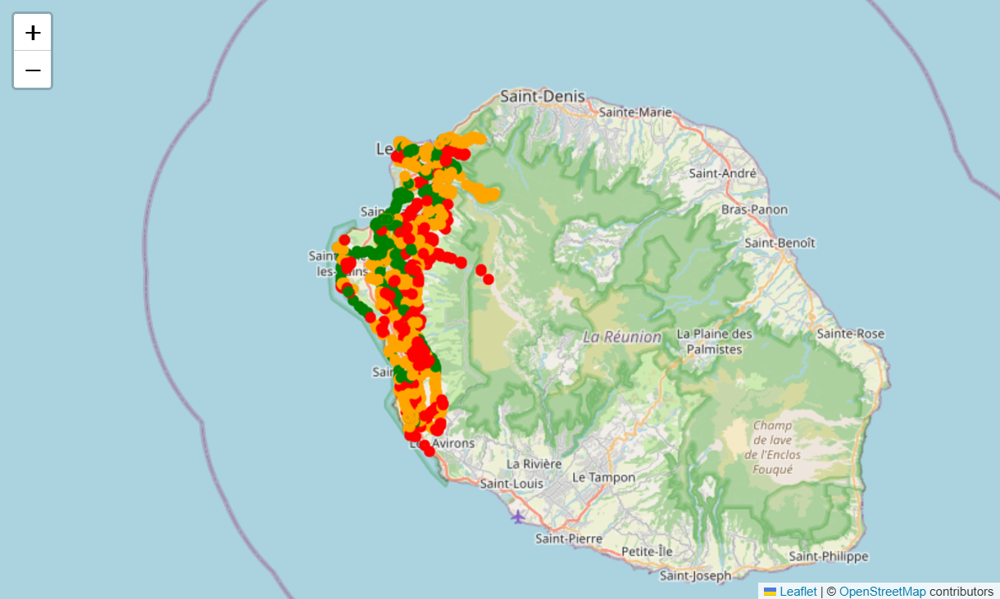
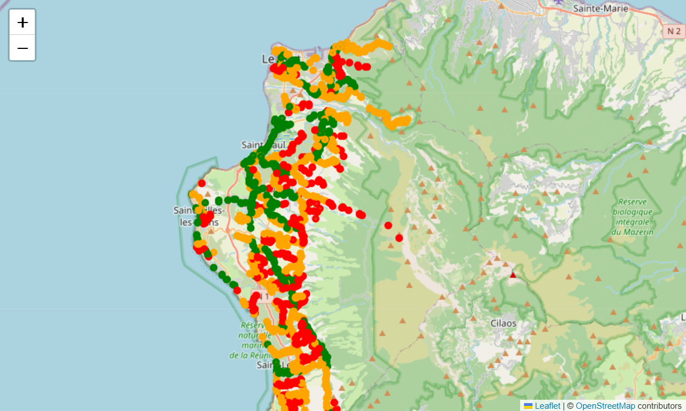
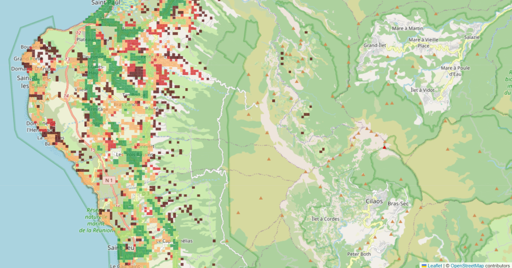
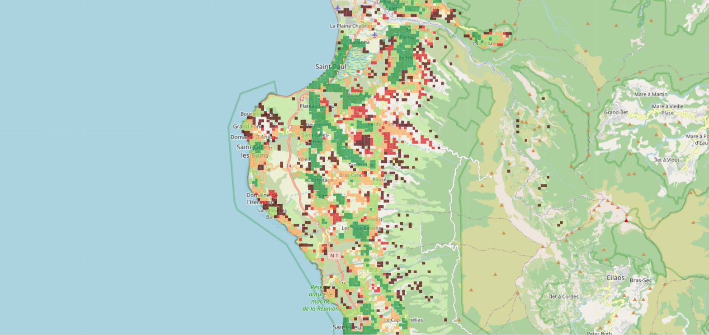

# Observations — Accessibilité aux bus dans l'Ouest de La Réunion

**Auteur :** Nicolas Law-Shun
**Dates de l'analyse :** 19 et 20 octobre 2026
**Notebook Fabric :** `nico_01_exploration_gtfs` (workspace « Hack _ Citiz x Microsoft »)
**Données :** GTFS Kar'Ouest + Car Jaune (bus) + INSEE Filosofi 2021 (population au carreau de 200 m)

---

## En bref

- **95 % des habitants de l'Ouest ont un arrêt de bus à moins de 400 m** (≈ 5 min à pied, à vol d'oiseau).
- **Le problème n'est donc pas la distance, c'est la fréquence** : un arrêt « moyen » voit passer environ **1 bus par heure**, sur **une seule ligne**.
- **Tous réseaux confondus (Kar'Ouest + Car Jaune) : ≈ 17 200 habitants (7,8 %)** n'ont **aucun arrêt** ou une offre **très faible** ; **≈ 51 000 (23 %)** sont en offre faible ou moins.
- **Ajouter Car Jaune change peu** : il renforce surtout des zones déjà desservies ; les plus mal desservis restent mal desservis.
- L'offre est **très concentrée** : la moitié des habitants vit dans le quart des carreaux les mieux desservis (littoral Le Port → Saint-Paul, Plateau Caillou, centre de Saint-Leu).
- **Candidats visibles** pour l'autopartage : un bloc dense **peu desservi dans les mi-pentes de Saint-Paul**, et le **littoral touristique** (Boucan Canot → La Saline-les-Bains), qui reste mal desservi même avec Car Jaune.

---

## 1. Les sources

| Donnée | Fichier | Provenance | Période / millésime |
|---|---|---|---|
| Bus Kar'Ouest (GTFS) | `gtfs-koa1808.zip` | transport.data.gouv.fr — fiche « Réseau Kar'Ouest » | du 17/08/2026 au 27/12/2026 |
| Cars Car Jaune (GTFS) | dossier `Bronze/gtfs/car_jaune/` du Lakehouse (déposé par l'équipe) | transport.data.gouv.fr *(fiche exacte à confirmer avec l'équipe)* | calendrier valide le 20/10/2026 |
| Population (carreaux 200 m) | `carreaux_200m_reun.csv` | INSEE — « Données au carreau de 200 m (y compris données imputées) », Filosofi 2021 — https://www.insee.fr/fr/statistiques/8735162 | revenus 2021, publié le 12/02/2026 |

**Emplacements dans Fabric :**
- GTFS : `Hack_Lakehouse / Files / Bronze / gtfs / karouest /` et `/ car_jaune /` (+ copie Kar'Ouest dans les Ressources du notebook).
- Population : Ressources du notebook uniquement (pas encore dans le Lakehouse partagé).

**Vérifications faites :**
- Ma copie du GTFS et celle de l'équipe dans le Lakehouse sont **identiques** (comparaison fichier par fichier).
- Le fichier INSEE couvre **la métropole, la Martinique et La Réunion — pas la Guadeloupe**.

> À compléter : URL exacte de la fiche Kar'Ouest et date de téléchargement.

---

## 2. Les bus (GTFS Kar'Ouest)

### Les arrêts

- **2 283 points d'arrêt**, tous avec des coordonnées valides et tous dans l'Ouest.
- Seulement **1 139 noms différents** : la plupart des arrêts existent en **double** (un point par côté de la route, `_a` = aller, `_r` = retour). Il y a donc environ **1 100 à 1 200 arrêts réels**.

### La desserte un mardi (20/10/2026)

- **1 920 trajets de bus** ; **2 264 arrêts** desservis (19 sans bus ce jour-là).
- Arrêt « moyen » (médiane), dans un sens : **18 bus par jour** (≈ 1 par heure), **1 ligne**.
- **Un quart des arrêts** ont **9 bus par jour ou moins**.
- Les 10 arrêts les mieux desservis sont tous à **Plateau Caillou** (Saint-Paul) : **plus de 200 bus par jour**, 11 à 12 lignes.

### Carte des arrêts

| Couleur | Passages par jour (un sens) | Signification |
|---|---|---|
| 🟢 Vert | plus de 27 | 25 % des arrêts les mieux desservis |
| 🟠 Orange | 10 à 27 | desserte moyenne |
| 🔴 Rouge | 9 ou moins | 25 % des arrêts les moins desservis |

Le vert suit le **littoral** et quelques **axes qui montent** (Plateau Caillou, Saint-Leu) ; le rouge domine dans les **mi-pentes et les Hauts**.

---

## 3. La population (INSEE)

### Contrôles

| Mesure | Valeur | Commentaire |
|---|---|---|
| Carreaux habités à La Réunion | 14 773 | les zones vides ne sont pas dans le fichier |
| Population totale La Réunion | **884 164** | cohérent (≈ +1,5 % par rapport au recensement : source fiscale, valeurs estimées) |
| Carreaux « imputés » (valeur estimée par l'INSEE, < 11 ménages) | 53 % des carreaux | mais seulement **9,5 % de la population** |

### L'Ouest (5 communes du TCO)

| Commune | Habitants |
|---|---|
| Saint-Paul | 105 576 |
| La Possession | 36 678 |
| Saint-Leu | 36 032 |
| Le Port | 34 054 |
| Trois-Bassins | 7 066 |
| **Total Ouest** | **219 406** (3 691 carreaux, ≈ 25 % de l'île) |

---

## 4. Croisement bus × population : qui a accès au bus ?

**Méthode (simple et explicable) :**
1. Pour chaque carreau de 200 m, on prend son **centre**.
2. On compte les arrêts à **moins de 400 m** (≈ 5 min à pied à 5 km/h, **à vol d'oiseau**).
3. On additionne les **passages de bus** de ces arrêts le mardi 20/10 → un **indice d'offre** du carreau.

### Résultats

| Mesure | Valeur |
|---|---|
| Habitants avec au moins un arrêt à moins de 400 m | **209 420 (95,4 %)** |
| Habitants sans arrêt à moins de 400 m | **9 986** |
| Distance médiane à l'arrêt le plus proche | **181 m** |
| Distance maximale | **5 945 m** (carreau très isolé) |

### Habitants par niveau d'offre

| Niveau (passages à moins de 400 m) | Habitants | Part |
|---|---|---|
| ⬛ Aucun arrêt | 9 986 | 4,6 % |
| 🟥 Très faible (< 32) | 7 714 | 3,5 % |
| 🟧 Faible (32 à 94) | 39 114 | 17,8 % |
| 🟩 Correcte (95 à 211) | 56 902 | 25,9 % |
| 🟢 Forte (212 et plus) | 105 690 | 48,2 % |

*Les seuils viennent des données (quartiles des carreaux), ils ne sont pas choisis arbitrairement.*

### Carte des carreaux

### Ce qu'on lit sur la carte

1. 🟢 **Zones bien desservies** : Plateau Caillou, Fleurimont, Saint-Gilles-les-Hauts, Bellemène, centre de Saint-Leu, secteur des Trois-Bassins.
2. 🟥 **Un bloc dense peu desservi dans les mi-pentes de Saint-Paul** (entre Bellemène, Petite France et Tan Rouge) : beaucoup de carreaux collés → **beaucoup d'habitants avec peu de bus**. **Premier candidat** pour l'autopartage.
3. ⬛ **Carreaux isolés dans les Hauts** : habitat dispersé, peu d'habitants par carreau.
4. ⬛ **Carreaux isolés au cœur de l'île**, visuellement dans le **cirque de Mafate** *(à confirmer par le calcul)* — zone **sans route** : ni bus ni voiture partagée possibles → **à exclure des recommandations**.
5. ⚠️ **Le littoral touristique apparaît foncé/rouge** (Boucan Canot, Grand Fond, Saint-Gilles-les-Bains, l'Hermitage, La Saline-les-Bains). Hypothèse de départ : ces zones seraient desservies par Car Jaune, pas encore inclus → **testée ci-dessous, et largement réfutée**.

### Ajout de Car Jaune (cars interurbains)

**Méthode :** le calcul « offre de bus par arrêt » a été transformé en **fonction réutilisable** `offre_par_arret(dossier, date, réseau)`. Elle a été **validée** en retrouvant à l'identique les chiffres du calcul manuel sur Kar'Ouest (3 services, 1 920 courses, 2 264 arrêts), puis appliquée à Car Jaune **sans modification** — exactement le principe « même moteur, autres données » du brief.

| Réseau (mardi 20/10/2026) | Services actifs | Courses | Arrêts desservis |
|---|---|---|---|
| Kar'Ouest | 3 | 1 920 | 2 264 |
| Car Jaune (toute l'île) | 1 | 566 | 319 |

**Habitants de l'Ouest par niveau d'offre, avant / après Car Jaune** (mêmes seuils) :

| Niveau | Kar'Ouest seul | Kar'Ouest + Car Jaune | Écart |
|---|---|---|---|
| ⬛ Aucun arrêt | 9 986 | 9 728 | −258 |
| 🟥 Très faible | 7 714 | 7 452 | −262 |
| 🟧 Faible | 39 114 | 34 173 | −4 941 |
| 🟩 Correcte | 56 902 | 59 109 | +2 207 |
| 🟢 Forte | 105 690 | 108 944 | +3 254 |

**Ce qu'on en retient :**
- Environ **5 500 habitants** changent de niveau, surtout de « Faible » vers « Correcte/Forte » : Car Jaune **renforce des zones déjà desservies**.
- Les **plus mal desservis ne bougent presque pas** (« Aucun » + « Très faible » : 17 700 → **17 180**, soit −3 %).
- **L'hypothèse sur le littoral est donc largement fausse** : même avec Car Jaune, le littoral touristique reste mal desservi à pied. *Explication possible (non vérifiée) : Car Jaune emprunte surtout les grands axes rapides (route des Tamarins) avec peu d'arrêts, pas les quartiers du bord de mer.*
- **Bonne nouvelle méthodologique :** les deux réseaux présents dans l'Ouest sont inclus, et le biais redouté s'avère **faible**.

**Carte des carreaux — tous réseaux (version à présenter) :**

---

## 5. Ce que ça veut dire pour le projet

1. **La proximité ne suffit pas** : presque tout le monde a un arrêt proche, mais avec peu de bus. Notre indicateur d'accessibilité doit combiner **distance ET fréquence**.
2. **L'autopartage a du sens là où le bus passe rarement** : il ne s'agit pas d'ajouter des arrêts, mais d'offrir une solution quand le bus ne suffit pas.
3. **Cible prioritaire** : zones **habitées** + offre **très faible ou nulle** + **accessibles en voiture** (donc hors Mafate).
4. **Plateau Caillou** et le littoral Le Port → Saint-Paul : beaucoup de bus → une station Citiz y servirait plutôt l'**intermodalité** (bus + voiture).
5. **Le littoral touristique** (Boucan Canot → La Saline-les-Bains) devient un **candidat réel** : résidents peu desservis à pied, et **probablement** une demande touristique *(non mesurée : Filosofi ne compte que les résidents)*.
6. **Chiffre clé pour le jury :** « Environ **17 200 habitants de l'Ouest (7,8 %)** n'ont aucun bus ou presque à moins de 5 min à pied, **tous réseaux confondus**. »

---

## 6. Limites

- **Distance à vol d'oiseau** : avec le relief, la marche réelle est plus longue → l'accès est **surestimé** (95 % est un chiffre optimiste).
- **Centre du carreau** : un habitant peut être jusqu'à ≈ 140 m du centre.
- **Un seul jour** analysé (mardi) ; week-end et vacances scolaires différents.
- **L'indice d'offre compte un même bus plusieurs fois** s'il passe par plusieurs arrêts proches (et aller + retour) : c'est un indice, pas un nombre exact de bus disponibles.
- **Réseaux inclus : Kar'Ouest + Car Jaune.** Le téléphérique et les réseaux des autres microrégions ne concernent pas l'Ouest. Pas encore de vélos/trottinettes en libre-service (GBFS) ni de taxis.
- **Le carreau de 5,9 km et les carreaux du cœur de l'île** n'ont pas encore été vérifiés par le calcul (Mafate ?).
- **Population Filosofi 2021** : source fiscale, proche mais différente du recensement ; 9,5 % de la population est dans des carreaux à valeur estimée.
- Les cartes ci-dessus sont des **photos** : pour la démo, il faudra les relancer en direct depuis le notebook.

---

## 7. Points d'organisation pour l'équipe

- **Téléchargements bloqués à l'école** : le zip INSEE (87 Mo) s'arrête à 15 Mo sur le réseau de l'école (2 essais, même résultat). **Solution :** le télécharger **directement depuis un notebook Fabric** (`requests.get(...)`), qui ne passe pas par le réseau de l'école. Ça a marché du premier coup.
- **Phase 3 du brief (Guadeloupe)** : les carreaux INSEE **ne couvrent pas la Guadeloupe**. Il faudra une autre source de population (IRIS ou commune) ou choisir la **Martinique** (couverte).
- **Deux dossiers `Bronze` et `bronze`** dans le Lakehouse : n'en garder qu'un.
- ✅ **`telepherique`** a été sorti de `karouest` et a maintenant son propre dossier.
- ✅ **`car_jaune`** contient maintenant `calendar.txt` et `calendar_dates.txt` (absents au début).
- **`Bronze/Carreau/`** existe mais est **vide** (le 20/10 vers 11 h) : si quelqu'un bloque sur le téléchargement INSEE, voir l'astuce ci-dessus — ou récupérer mon `carreaux_200m_reun.csv`.
- **Dossier `Silver/`** apparu : à documenter (qui l'alimente, avec quoi ?).
- **Dossiers `test`** : à supprimer avant la démo.
- **Travail à plusieurs dans un même notebook** : Fabric synchronise en direct ; si deux personnes modifient le même notebook, elles s'écrasent. Chacun son notebook (ou « Enregistrer sous » pour dupliquer).
- **Ordre des cellules** : une cellule ne peut utiliser que ce qui est créé **au-dessus** d'elle → toujours vérifier que « Tout exécuter » passe de bout en bout.
- **Bibliothèques à installer dans Fabric** : `folium` (cartes) et `pyproj` (conversion de coordonnées) ne sont pas présentes par défaut. Mettre `%pip install folium pyproj` **en toute première cellule** (l'installation redémarre Python). Idée : un **Environnement Fabric** partagé pour toute l'équipe.
- **Fond de carte** : `cartodbpositron` demande maintenant une clé API → utiliser `OpenStreetMap`.

---

## 8. Prochaines étapes

1. ✅ ~~Ajouter Car Jaune~~ — fait (impact faible, voir section 4).
2. **Vérifier et exclure les carreaux inaccessibles en voiture** (Mafate).
3. Définir un **score d'accessibilité** combinant distance et fréquence.
4. **Objectif 3 (cœur du projet)** : identifier les **emplacements candidats** (habités + peu desservis), estimer le **nombre d'habitants nouvellement couverts** par une station Citiz, puis **prioriser sous contrainte de budget**.
5. Appliquer la même fonction aux **autres microrégions** (Citalis, Estival, Alternéo, CarSud) → Phase 2 du brief.
6. Déposer la population INSEE dans le Lakehouse partagé **avec l'accord de l'équipe** (le dossier `Bronze/Carreau/` semble prévu pour ça).
